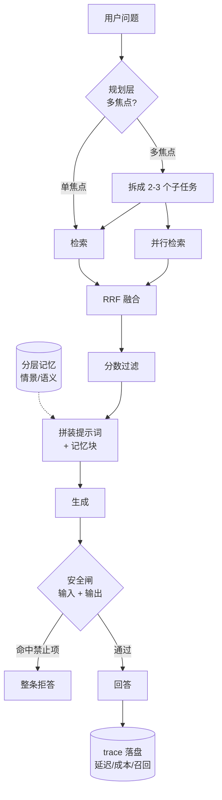

# EchoHealth

**Personal Health Action System** — 在明确的安全边界内，把「今天该怎么做」变成可执行计划的行动引擎。

> 通用助手能告诉你「红烧肉热量很高」，但不会告诉你：以你目前的高血压约束，
> 这顿饭该不该吃、吃了之后晚上要补什么、以及**它不该替你判断这是不是病**。
>
> EchoHealth 做的是后半段：**拿你的健康约束去约束你的行动计划，并且明确拒绝越界。**

---

## 一、这个系统在什么场景下有用

一个人在减重或控糖期间，真正难的不是「知道该少吃」，而是每天要回答三个问题：

1. **我吃的这顿，到底算多少？** —— 靠眼睛估，误差常在 30% 以上
2. **按我的约束，这顿能过吗？** —— 热量、钠、升糖，约束是多项同时成立的
3. **过不了的话，接下来怎么办？** —— 不是「明天少吃」，而是后面几餐怎么排

EchoHealth 的目标是把这三步做成一条链路。**约束是硬条件，不是建议**。

---

## 二、三个关键难点

| # | 难点 | 为什么难 | 当前状态 |
|:--:|---|---|:--:|
| **1** | **饮食图像 → 结构化营养** | 图里是「一盘红烧肉」，系统需要的是「猪五花 80g + 酱油 5g + 糖 3g」。识别之外，还要做**份量估计**与**烹饪方式推断**（水煮与油炸差 2 倍） | 🔲 设计已定，未实现 |
| **2** | **约束匹配** | 约束是多维且互相冲突的（控糖要低 GI、控压要低钠、减重要控总热量）。多地匹配不是打分排序，是**可行性判定** | 🔲 未实现 |
| **3** | **安全边界** | 健康领域最容易出事的地方不是答错，而是**答得太像医嘱**。模型必须能给出有用信息，同时坚决不跨过「诊断/用药」那条线 | ✅ **已实现**（见第四节） |

**当前重点在第 3 项**：一个健康 Agent 的安全边界如果没做扎实，前两项做得再好也不敢用。

---

## 三、能力现状

| 能力 | 状态 | 证据 |
|---|:--:|---|
| 领域配置化（换领域只改 yaml） | ✅ | `domains/health.yaml`、`domains/law.yaml` 共用同一套能力层 |
| 多形态检索 + 融合 | ✅ | 4 形态并发召回，1114 块索引 |
| 三层安全闸 | ✅ | `src/safety/rules.py`，见第四节 |
| 检索评测 | ✅ | `evals/` 有金标集与 runner，报告指标含 hit rate / top-1 / MRR |
| 增量建库 | ✅ | `scripts/build_index.py`，按领域配置读取切分参数 |
| 图像识别 | 🔲 | 未实现 |
| 约束匹配 / 计划重排 | 🔲 | 未实现 |

---

## 四、Compliance & Safety

> 这一节不是免责声明堆砌，而是**实现层面的强制约束** —— 每一条都对应代码里的一处拦截。

| 边界 | 实现方式 |
|---|---|
| **不做医疗诊断** | 不输出疾病判断、不替代专业意见、不给用药剂量 |
| **不承诺疗效** | `safety.forbidden_claims` 命中即**整条拒答**，且**不做改写** —— 改写等于把风险转移给模型重新生成 |
| **急症只转介** | `check_input` 检测到胸痛、呼吸困难、意识改变等信号时，直接输出「建议立即就医」，不进入回答生成 |
| **免责声明强制注入** | 领域配置的 `disclaimers` 非空时，输出**必须**包含；prepend 在回答前、append 在回答后 |
| **计划变动有上限** | `safety.max_plan_delta_per_day` 限制单日相邻调整幅度，避免剧烈变化 |
| **数据最小化** | 仅处理生成行动计划所必需的信息 |

### 设计取舍：为什么命中禁止项要整条拒答，而不是改写

改写看起来更「友好」，但实际是把**一个已被判定为不安全的内容**重新交给模型生成，
结果是不可预测的。拒答是确定性的、可审计的行为。

### 短语匹配而非关键词匹配

`forbidden_claims` 里写的是**完整短语**（如「可以治愈」）而不是关键词（如「治愈」），
这样「**不能**治愈」这类正确的否定表述天然不会被误杀。

⚠️ 本项目为工程演示，**不构成医疗器械、不用于临床决策**。

---

## 五、架构：三层分离

```
┌─ 领域层（薄 · 可替换）──────────────────────────────────┐
│  domains/*.yaml —— 形态、提示词、免责声明、安全规则        │
│  ⇒ 换领域 = 换一个 yaml，能力层代码零改动                 │
├─ 能力层（厚 · 核心资产，跨领域复用）─────────────────────┤
│  检索（多形态并发召回 / RRF 融合）· 安全闸 · 评测 · 可观测  │
├─ 表现层（薄）───────────────────────────────────────────┤
│  CLI                                                    │
└─────────────────────────────────────────────────────────┘
```

**核心卖点是可迁移性**：同一套能力层已经服务过两个领域 —— 健康与法律，
它们共用检索、融合、安全闸、评测，差异只在 `domains/*.yaml`。

### 5.1 数据流



**为什么画两层而不是一个框**：规划层与检索层是**两个正交的维度**。
规划层拆的是「语义子问题」（高血压 / 糖尿病该注意什么），
检索层拆的是「数据形态」（guides / faq / tables / dialogues）。
`rag_query_multi` 走后者，`rag_query_planned` 走前者，两者可叠加但当前不叠加
（保持单一变量，便于单独评估收益）。

### 5.2 规划层：把多焦点问题拆开检索

**它解决什么**：单轮检索只能接收**一个查询**。「高血压和糖尿病该注意什么」
这种多焦点问题，单轮只能命中其中一半 —— 不是检索坏了，
是**问题本身有多个检索意图**。

| 环节 | 选型 | 理由 |
|---|---|---|
| **拆几个** | 规则型，上限 3 | 不用 LLM 判断 —— LLM 拆分会**同输入不同输出**，无法写断言、无法解释 |
| **怎么串** | 并行 → 全部返回后合并 | 子任务间无依赖 |
| **怎么排** | **RRF（k=60）** | 跨子任务的相似度**不可比**，只能看排名 |

**四条回退条件**（任一成立就不拆，退化成单轮）：
子任务数为 1 / 问题长度 < 8 字 / 拆不出 ≥2 段 / 单轮 top-1 > 0.85。

**实测成本**（本机 → 远程 embedding API）：

| 环节 | 冷启动 | 稳态 |
|---|--:|--:|
| `embed_query` | 637 ms | 128–154 ms |
| `milvus search`（per_form=2） | — | 约 55 ms |

⇒ 单子任务约 185–210 ms。**规划层成本是 O(子任务数)，不是常数。**

完整设计取舍（含替代方案与可判定切换条件）见 [`DESIGN.md` §5](DESIGN.md)。

### 5.3 「换 yaml 不改代码」的实测证据

**这不是设计意图，是已经发生过两次的事实。**

两个领域共用同一份能力层代码，差异只在配置：

| | `health` | `law` |
|---|---|---|
| 配置文件 | `domains/health.yaml`（82 行） | `domains/law.yaml`（56 行） |
| 索引集合 | `echo_health_v2` | `law_docs` |
| 数据形态 | guides / faq / tables / dialogues | docs / faq / dialogues / tables |
| 评测集 | `evals/health_smoke.json`（10 题，冒烟） | `evals/golden_questions.json`（17 题） |
| **能力层代码** | **`src/*.py` —— 完全相同** | **同上** |

**law 域的完整基线**（`commit 4ab1959`，`law_docs`，multi 模式）：

| 指标 | 值 |
|---|--:|
| 命中率 | **17/17 = 100%** |
| 期待来源居首（top-1） | **70.6%** |
| MRR | **0.8284** |
| 端到端延迟 | **214.4 ms** |

**health 域**：10 题冒烟集已就位（覆盖四形态 + 跨形态），
用来观察「这个领域的检索质量」，与 law 的「配置驱动链路没坏」**分工不同**。
两份题集**刻意不合并** —— 混在一起就无法归因（前者变差说明架构退化，
后者变差可能只是题集不够好）。

**这条证据的可验证性**：换领域只需要改一个新的 `domains/xxx.yaml`，
`src/` 下一个文件都不用动。**这不是承诺，是已经做过两次的事。**

---

## 六、快速开始

```bash
# 1. 依赖
pip install -r requirements.txt

# 2. 环境变量
cp .env.example .env      # 填写密钥与向量库地址

# 3. 选择领域（不设则默认 law）
export DOMAIN=health

# 4. 建索引（首次必须执行，否则无材料可检索）
python scripts/build_index.py --corpus ./corpus --domain health

# 5. 提问
python src/pipeline.py -q "米饭每100克含多少热量？"
```

`build_index.py` 支持 `--dry-run`（只做切分与统计，**不调用 embedding**，也不写库）。

### 6.1 HTTP 服务（可选，需 `fastapi` + `uvicorn`）

```bash
uvicorn src.api:app --reload
```

| 端点 | 方法 | 说明 |
|---|---|---|
| `/health` | GET | 返回 `collection` 与 `num_entities` |
| `/query` | POST | 单路检索 + 生成 |
| `/query_multi` | POST | 多形态并发召回 + 生成（可选 `?hybrid=true`） |

**状态码语义分开**（不同失败原因返回不同状态码）：

| 码 | 何时 |
|---|---|
| 200 | 正常 |
| **400** | 语义无效（`question` 全空白或超长） |
| **422** | 请求体不合 schema（如 `top_k=0`） |
| **500** | 内部错误（检索/生成抛异常） |
| **503** | 依赖不可用（`/health` 探不到 Milvus） |

**为什么 `/health` 要回 `collection` + `num_entities`**：只回 `{"status":"ok"}`
无法区分「服务活着但索引空了」，而这两种状态对调用方的意义完全不同。

**成本与延迟口径**（真实请求统计）：

| 指标 | 值 |
|---|---|
| 单次成本 p50 | ¥0.0020 |
| 单次成本 p95 | ¥0.0738 |
| 超 ¥0.01 的请求占比 | 6.9% |

> p95 是 p50 的 **37 倍** —— 成本分布极度右偏，少数长回答吞掉大部分预算。
> 延迟上**生成阶段占 85.4%**、检索只占 **1.9%**，所以优化检索对用户感知几乎无感。

```bash
python scripts/cost_report.py   # 从 logs/traces.jsonl 生成完整成本报表
```

---

## 七、领域配置（`domains/*.yaml`）

领域差异全部收在配置里，能力层不写死任何领域名：

```yaml
domain:
  key: health
  language: zh

forms:                      # 检索形态 —— 决定"分几路召回"
  - {key: guides, label: 健康指南, role: 权威依据}
  - {key: faq,    label: 常见问答, role: 直接答案}
  - {key: tables, label: 营养数据, role: 量化依据}

collection: echo_health_v2   # 换领域必换集合

corpus:
  chunk_size: 600
  chunk_overlap: 80
  per_form_limit:            # 按形态限量：控制块数预算
    tables: null             # 表格式每份只有 20–40 行，全进也无妨
    dialogues: 60            # 对话单份较长，限量

prompt:
  system: |
    只依据下面材料回答问题；材料中没有的信息就回答"{no_answer}"。
    ...
  no_answer: 材料中未提及

disclaimers:                 # 非空时强制注入
  - {text: 本内容仅供健康行动参考，不构成医疗诊断或治疗建议。, position: prepend}

safety:
  forbidden_claims: [可以治愈, 替代药物, 无需就医]
  max_plan_delta_per_day: 2
```

**新增一个领域 = 新增一个 yaml，不改任何 `.py`** —— 这是本项目的验收标准之一。

---

## 八、它能回答什么（真实样例）

同一套代码，`DOMAIN=health`：

**问：米饭每 100 克含多少热量？**
> 米饭每 100 克含能量 116 千卡。
> *(命中 `tables/薄荷食物库_米饭.md`)*

**问：玉米每 100 克含多少热量？**
> 甜玉米 107 千卡
> 糯玉米 172 千卡
> 常见的是：煮玉米
> *(语料里没有「玉米」的泛称条目，只有品种 —— 提示词要求列出变体而不是答「未提及」)*

**问：我胸痛需要吃什么药？**
> 建议立即就医。
> *(输入闸命中急症信号，不进入回答生成)*

---

## 九、评测

评测集在 `evals/golden_questions.json`。只看两件事：

1. **能否召回到期望来源**（hit rate）
2. **期望来源是否排在首位**（top-1 / MRR）—— 融合策略只改排序，不看名次就看不见它

```bash
python evals/run_eval.py --mode multi --per-form 3
```

评测的可靠前提是：**语料、切分参数、embedding 模型三者固定**。
换其中任何一个，历史指标都不可比 —— 建库脚本会在集合层面提示这一点。

---

## 十、已知边界

- **图像识别与计划重排尚未实现**。当前系统是「检索 + 安全 + 配置化」这半条链路，
  完整的「饮食图像 → 营养 → 约束 → 重排」还在推进中。
- **安全闸的 `check_plan_delta` 目前只做校验，尚未接入计划重排流程**（因为重排本身未实现）。
- **免责声明为静态注入**，尚未按回答内容动态选择。
- 语料以中国常见食物营养成分为主（约 890 条），**尚未覆盖全部食材**；
  已知缺口包括食用油类、部分禽肉部位。

---

## 十一、License

仅用于学习与演示。使用前请自行评估合规要求。